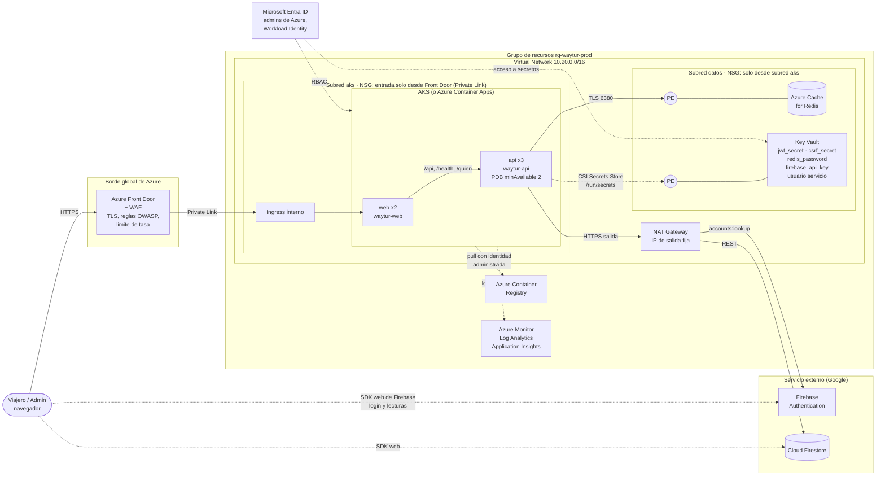

# WayTure en Azure: arquitectura de referencia

> Documento de **diseño, no de despliegue**. Lleva a Azure lo que este
> repositorio ya corre en Docker Compose y en Kubernetes (kind), sin cambiar
> el código. La base de datos **sigue en Firebase** (Auth + Firestore).

## 1. Punto de partida

| Pieza | En el repo | Imagen / tecnología |
|---|---|---|
| Web | Nginx sin privilegios: HTML/CSS/JS, Leaflet y el widget React compilado | `waytur-web:1.0` |
| API | Node 22, `http` nativo, JWT HS256 + CSRF, sin estado | `waytur-api:1.0` / `1.1` |
| Identidad | Firebase Authentication (el servidor verifica el `idToken` con `accounts:lookup`) | SaaS externo |
| Datos | Cloud Firestore por REST; respaldo JSON local en `DATA_DIR` (modo degradado) | SaaS externo |
| Caché | Redis 7.4 con contraseña, TTL 30 s, degradación elegante | `redis:7.4.6-alpine` |
| Secretos | Archivos en `/run/secrets` (Compose secrets / K8s Secret) leídos con `*_FILE` | `leerSecreto()` |

Como `config.js` ya lee cada secreto desde un **archivo**, pasar a Key Vault
no toca el código: el driver CSI de Key Vault monta los secretos como
archivos en la misma ruta.

## 2. Diagrama

> Mermaid se ve dibujado en GitHub y en VS Code (con extensión). Para tener
> una **imagen** para el informe, pega el bloque en <https://mermaid.live> y
> exporta PNG o SVG. **Es un paso manual.**

**Flujo de un login:**
1. El navegador inicia sesión con el SDK de Firebase y obtiene un `idToken`.
2. Pide `GET /api/auth/csrf`; esa petición llega por Front Door a Nginx y a
   la API.
3. Envía `POST /api/auth/token {idToken, csrfToken}`.
4. La API verifica el `idToken` contra Firebase. La salida pasa por el NAT
   Gateway, con IP fija, por si se quiere restringir.
5. La API lee el rol en Firestore y firma su propio JWT con `JWT_SECRET`,
   que sale de Key Vault y es el mismo en las 3 réplicas.
6. Las escrituras siguientes llevan `Authorization: Bearer` y `X-CSRF-Token`.

## 3. Clasificación IaaS / PaaS / SaaS

| Componente de WayTure | Servicio | Modelo | Qué gestiona el equipo |
|---|---|---|---|
| Autenticación de usuarios | **Firebase Authentication** (Google) | **SaaS / BaaS externo** | Proveedores de login, dominios autorizados, restricciones de la API key |
| Base de datos | **Cloud Firestore** (Google) | **SaaS / BaaS externo** | **Reglas de seguridad**, estructura de colecciones, backups/exportaciones |
| Entrada, TLS, WAF | Azure Front Door Premium + WAF | PaaS | Reglas WAF, dominio, certificados |
| Orquestación | AKS | PaaS (el plano de control lo gestiona Azure; los nodos son VMs del cliente) | Manifiestos, imágenes, versión de nodos |
| Alternativa simple | Azure Container Apps | PaaS / *serverless* | Imágenes, escalado, revisiones |
| Registro de imágenes | Azure Container Registry | PaaS | Imágenes, escaneo, retención |
| Caché | Azure Cache for Redis | PaaS | Tamaño, contraseña o Entra ID, red |
| Secretos | Key Vault | PaaS | Qué secretos existen, quién los lee, rotación |
| Identidad de administradores de Azure | Microsoft Entra ID | SaaS / IDaaS | Usuarios, grupos, roles, MFA |
| Observabilidad | Azure Monitor, Log Analytics, Application Insights | PaaS / SaaS | Alertas, consultas, retención |
| Red | VNet, subredes, NSG, Private Endpoints, NAT Gateway | IaaS (red virtual) | Direccionamiento, reglas, DNS privado |
| (Contraejemplo) la API en una VM con Docker | Azure Virtual Machines | **IaaS** | Todo: SO, parches, Docker, escalado, alta disponibilidad |

## 4. Equivalencias: laboratorio → Azure

| En el repo | En Azure | Por qué |
|---|---|---|
| `secrets/*.txt` + Compose `secrets:` | Key Vault | Fuera de imágenes y de Git, con auditoría y rotación |
| `kubectl create secret generic` (k8s-up.sh) | Key Vault + **CSI Secrets Store Driver** + Workload Identity | Los secretos llegan como archivos en `/run/secrets`, sin un Secret en texto plano (base64) en etcd |
| `*_FILE` / `leerSecreto()` | Igual, sin cambios | Ya lee archivos |
| Nginx (`web`) en 8080 | Front Door + WAF → Ingress interno | TLS, WAF y caché en el borde; Nginx sigue sirviendo los estáticos |
| Service `web` NodePort 30080 | Service `LoadBalancer` interno / Ingress | NodePort es solo para kind |
| `kind load docker-image` | `az acr build` o `docker push` a ACR + rol `AcrPull` | Los nodos descargan de un registro privado |
| Etiquetas `1.0` / `1.1` (nunca `latest`) | Igual, o por *digest* | Se sabe exactamente qué corre |
| Redis efímero (Deployment) | Azure Cache for Redis (TLS 6380) | SLA y réplica gestionada |
| Red `backend` *internal* | Subred de datos + NSG + private endpoints | Redis y Key Vault no son alcanzables desde internet |
| Red `frontend` (salida a Firebase) | NAT Gateway | Salida controlada con IP fija |
| 3 réplicas + `topologySpreadConstraints` por nodo | Nodos en **zonas de disponibilidad** (`topology.kubernetes.io/zone`) | Sobrevivir a la caída de un datacenter |
| PDB `minAvailable: 2` | Igual: AKS lo respeta al actualizar nodos | Mantenimiento sin caídas |
| Rolling update `maxUnavailable: 0` + preStop | Igual (o división de tráfico entre revisiones en Container Apps) | Despliegues sin caídas |
| `read_only`, `cap_drop: ALL`, no root, Pod Security *restricted* | Igual + Azure Policy para AKS | El mínimo privilegio verificado por política |
| `docker compose logs` / `kubectl logs` | Container Insights + Log Analytics | Logs centralizados y alertas |
| `/health` sin dependencias | Igual + *health probe* de Front Door | Un solo contrato de salud |

## 5. Modelo de responsabilidad compartida aplicado a WayTure

| Capa | Azure | Google (Firebase) | El equipo |
|---|---|---|---|
| Datacenter, hardware, red física | ✔ | ✔ | |
| Plano de control de AKS; servicio Redis gestionado | ✔ | | |
| Infraestructura de Auth y Firestore (disponibilidad, cifrado en reposo) | | ✔ | |
| **Reglas de Firestore**: quién lee y escribe cada colección | | | ✔ (hoy `usuarios` es legible sin sesión: ver [firestore-reglas.md](firestore-reglas.md)) |
| **Identidad de la app**: verificación del `idToken`, JWT HS256 (`exp`/`iat` obligatorios, solo HS256, firma en tiempo constante) | | | ✔ |
| **CSRF**: token ligado al claim `csrf` del JWT, comparado en tiempo constante | | | ✔ |
| **Autorización**: rol desde Firestore y no desde el cliente; solo admin lista usuarios y ubicaciones; cada usuario modifica solo sus viajes | | | ✔ |
| **Aplicación**: CSP y cabeceras en Node y Nginx, `escHtml()` en los popups de Leaflet, lista blanca de estáticos, límite de cuerpo de 1 MB | | | ✔ |
| **Red**: NSG, private endpoints, WAF, sin IP pública en AKS | Provee las herramientas | | ✔ configura |
| **Secretos**: generación, rotación, nunca en Git ni en imágenes | Key Vault los guarda | | ✔ decide y rota |
| **Contenedores**: imágenes fijas y parcheadas, usuario no root, raíz de solo lectura, sin capabilities | | | ✔ |
| **TLS** | Front Door emite y renueva certificados | HTTPS en sus APIs | ✔ dominio y HSTS |
| **Restricción de la API key web** (por *referrer* y por API) | | Provee la consola | ✔ |

Regla práctica: **el proveedor protege la nube; el equipo protege lo que pone
en ella**. Usar PaaS y SaaS reduce la columna del equipo, porque no parchea
servidores, pero identidad, datos (las reglas de Firestore) y código siempre
son responsabilidad del cliente.

## 6. Diferencia con el diseño del reto (Azure SQL) y por qué no es contradictorio

El diseño de referencia del reto pone **Azure SQL Database** como capa de
datos. WayTure usa **Firestore** y **se queda en Firestore**:

- **Mismo rol en la arquitectura**: las dos son bases de datos gestionadas.
  El equipo no administra servidores, pero sí el esquema o las colecciones,
  el control de acceso y los backups. En el diagrama ocupan la misma
  posición: detrás de la API y con su propio control de acceso.
- **Distinto proveedor y distinto modelo**:
  - Azure SQL es PaaS **dentro** de la VNet, alcanzable por private
    endpoint.
  - Firestore es SaaS **externo**: se llega por HTTPS a Google, y la
    frontera de seguridad son sus **reglas**, no un NSG.
  - Por eso el diagrama agrega un NAT Gateway para la salida y no pone un
    private endpoint hacia la base.
- **El navegador también habla con Firestore** (SDK web). Con Azure SQL eso
  sería imposible y todo pasaría por la API. Esa diferencia es la razón por
  la que las reglas de Firestore son críticas en WayTure.
- **Por qué no migrar**: toda la app (registro, paneles, rastreo) usa el SDK
  de Firebase. Migrar a Azure SQL implicaría reescribir el frontend y la
  autenticación, sin aportar nada a los objetivos del reto (contenedores,
  orquestación, seguridad por capas, alta disponibilidad), que se cumplen
  igual.
- **Lo que sí aplica igual**:
  - Key Vault para secretos;
  - WAF y TLS en el borde;
  - la API sin estado con varias réplicas;
  - monitoreo centralizado;
  - el principio de mínimo privilegio, que en Firestore se expresa en sus
    reglas en lugar de en usuarios de SQL.

## 7. Riesgos y pendientes si se despliega de verdad

- **Escrituras de la API en Firestore**: requieren el usuario servicio
  ([firestore-reglas.md](firestore-reglas.md)). Sin él, cada réplica escribe
  solo en su JSON local y los datos divergen.
- **Reglas de Firestore**: `usuarios` es legible sin sesión. Hay una
  propuesta en `firestore.rules`, pendiente de publicar y probar.
- **Rotar `JWT_SECRET`** invalida todos los JWT vigentes. Hacerlo sin cortes
  requiere aceptar dos claves (`kid`), y hoy no está implementado.
- **Caché**: si los listados se filtraran por usuario, la clave debe incluir
  el `uid` del JWT (ver `cache.js`).
- **Costo**: AKS con Front Door Premium no es barato para un proyecto
  académico. La variante económica con el mismo diseño es Container Apps más
  Front Door Standard.
